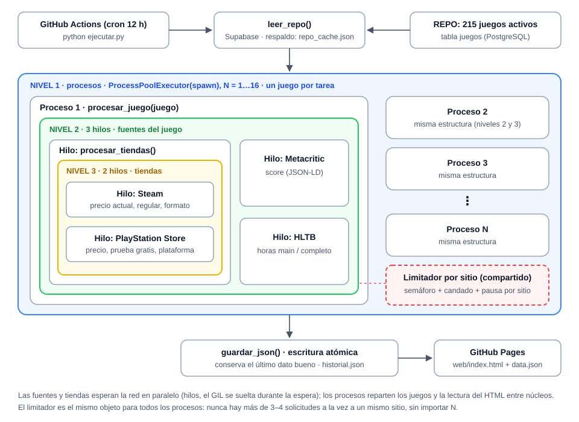
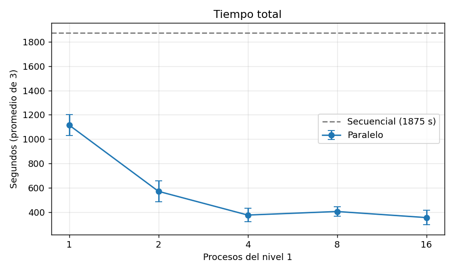
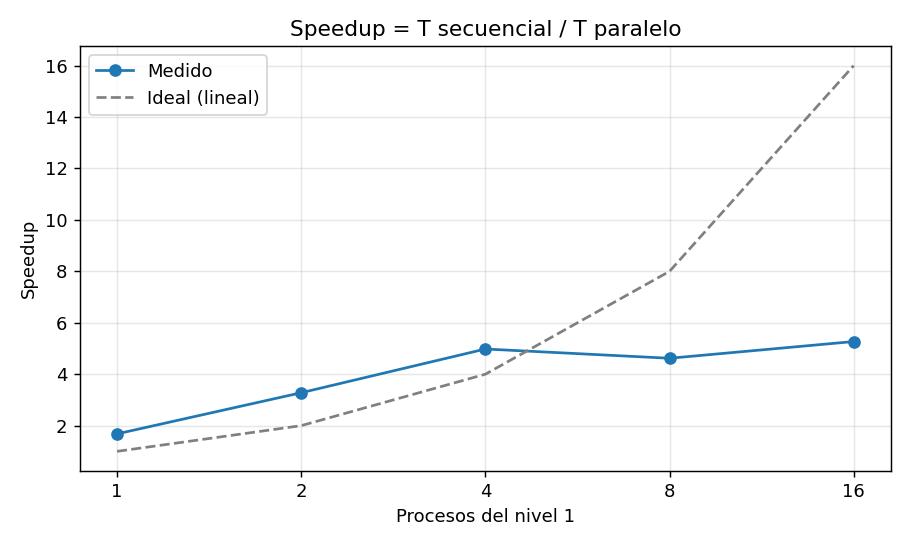
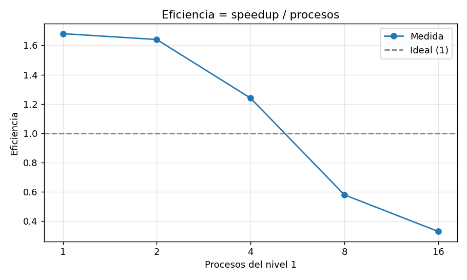

<div class="portada">
<p>Instituto Tecnológico de Costa Rica — Campus San Carlos</p>
<p>IC3101 Arquitectura de Computadoras</p>
<h1>III Proyecto: Web Scraping Multinúcleo y Sitio Web</h1>
<p class="sub">Documento técnico</p>
<p>Integrante 1</p><p>Integrante 2</p><p>Integrante 3</p>
<p style="margin-top:2cm">Sitio público: https://alonso-rodriguez-bolanos.github.io/proyecto3/</p>
<p>Repositorio: https://github.com/alonso-rodriguez-bolanos/proyecto3</p>
<p>15/11/2026</p>
</div>

<div class="indice" markdown="1">

# Contenido

1. Arquitectura de la solución
2. Estructura del REPO y cómo se actualiza
3. Estrategia de web scraping por sitio e indicador de oferta
4. Manejo de errores y actualización recurrente
5. Análisis de rendimiento
6. Instalación, uso y URL pública

</div>


# 1. Arquitectura de la solución

El sistema lee la lista de juegos (REPO) de Supabase, consulta para cada juego dos tiendas, Metacritic y How Long To Beat usando tres niveles de paralelismo, guarda el resultado en `web/data.json` y lo publica en una página estática de GitHub Pages. GitHub Actions repite todo cada 12 horas.



## 1.1 Componentes

| Componente | Archivo | Qué hace |
|---|---|---|
| Programa principal | `ejecutar.py` | Lee el REPO, llama al motor, guarda el JSON y escribe las métricas de la corrida en `logs/metricas.jsonl` |
| Lectura del REPO | `scraper/repo.py` | Descarga los juegos activos de Supabase; si falla usa la copia local `datos/repo_cache.json` |
| Nivel 1 | `scraper/nivel1.py` | Reparte los juegos entre procesos |
| Nivel 2 | `scraper/nivel2.py` | Consulta las fuentes de un juego en hilos y arma su registro |
| Nivel 3 | `scraper/tiendas.py` | Consulta las tiendas de un juego en hilos |
| Scrapers | `scraper/tiendas.py`, `metacritic.py`, `hltb.py` | Extraen los datos de cada sitio |
| Red | `scraper/red.py` | Descarga con timeout, reintentos y el límite del sitio |
| Limitador | `scraper/limitador.py` | Controla cuántas solicitudes van a cada sitio a la vez, compartido por todos los procesos |
| Guardado | `scraper/guardar.py` | Combina con el JSON anterior, escribe de forma atómica y actualiza el historial de precios |
| Gestor | `gestor.py` | Ventana para agregar, editar y desactivar juegos del REPO |
| Página | `web/index.html` | Tarjetas, filtros, ordenamiento, detalle, comparador y rendimiento |
| Actualización | `.github/workflows/actualizar.yml` | Cron de 12 h y publicación en GitHub Pages |

## 1.2 Los tres niveles de paralelismo

| Nivel | Qué se reparte | Herramienta | Cuántos | Por qué |
|---|---|---|---|---|
| 1 | Juegos | `ProcessPoolExecutor` con contexto `spawn` | `WORKERS_JUEGOS`, por defecto los núcleos de la máquina | Cada proceso tiene su propio intérprete y su propio GIL, así que es el único nivel que usa varios núcleos de verdad (por ejemplo para leer el HTML con BeautifulSoup) |
| 2 | Fuentes de un juego: tiendas, Metacritic y HLTB | `ThreadPoolExecutor` | 3 hilos | Las tres fuentes pasan casi todo el tiempo esperando la red; mientras esperan sueltan el GIL, así que los hilos alcanzan y son más baratos que procesos |
| 3 | Tiendas de un juego: Steam y PlayStation Store | `ThreadPoolExecutor` | 2 hilos | Mismo motivo: un juego tarda lo que su tienda más lenta y no la suma de las dos |

Un juego viaja así: el nivel 1 le da el juego a un proceso libre; dentro de ese proceso `procesar_juego` abre 3 hilos (nivel 2); el hilo de tiendas abre otros 2 hilos (nivel 3). Cuando las fuentes terminan, el registro vuelve al proceso principal, que ordena todos por `id` y llama a `guardar_json`.

Se eligió `spawn` en vez de `fork` porque es el único que existe en Windows y se comporta igual en Windows, macOS y Linux, así el benchmark y GitHub Actions corren el mismo código.

## 1.3 Sincronización

- **Limitador por sitio compartido entre procesos.** El proceso principal crea, por cada sitio, un `BoundedSemaphore` (cuántas solicitudes a la vez), un `Lock` y un `Value` compartido con la hora del próximo turno libre. Se pasan a cada proceso hijo en el `initializer` del pool. Antes de cada descarga, `with turno(sitio)` toma un cupo del semáforo y reserva su turno dentro del candado; la espera se hace fuera del candado para no bloquear a los demás. Así, aunque haya 16 procesos, a Steam nunca le llegan más de 4 solicitudes a la vez ni a los demás sitios más de 3.
- **Log de varios procesos.** Cada hijo manda sus mensajes a una `multiprocessing.Queue`; un solo `QueueListener` en el proceso principal los escribe al archivo, así las líneas no se mezclan.
- **Resultados.** Los registros vuelven por los `Future` del pool (`as_completed`), sin memoria compartida ni candados extra. Solo el proceso principal escribe el `data.json`.
- **Tiempo máximo por juego.** El nivel 2 espera a cada fuente con un tope común (`TIMEOUT_FUENTE_S`, 180 s); una fuente colgada queda con error y no detiene al juego. Al terminar se usa `shutdown(wait=False, cancel_futures=True)` para no esperar hilos colgados.
- **Proceso que muere.** Si un proceso hijo se cae (`BrokenProcessPool`), sus juegos se repiten una vez en un pool nuevo; si vuelve a fallar quedan marcados con error y los demás juegos se guardan igual.

## 1.4 Formato del `data.json`

Un registro por juego:

```json
{
  "id": 12, "nombre": "Hades", "imagen": "https://…", "plataformas": ["PC", "PS5"],
  "fecha_lanzamiento": "2020-09-17", "precio_sugerido": 24.99,
  "tiendas": [
    {"tienda": "Steam", "ok": true, "precio_actual": 6.24, "precio_regular": 24.99, "descuento_pct": 75,
     "en_oferta": true, "formato": "Digital", "plataforma": "PC", "url": "https://store.steampowered.com/app/1145360/"}
  ],
  "metacritic": {"ok": true, "score": 93},
  "hltb": {"ok": true, "horas_main": 23.6, "horas_completo": 95.3},
  "ultima_actualizacion": "2026-11-15T18:00:00+00:00"
}
```

Si una fuente falla, su entrada queda con `"ok": false` y el texto del error; si había un dato anterior bueno, se conserva con `"desactualizado": true` (sección 3.10).

# 2. Estructura del REPO y cómo se actualiza

El REPO es la tabla `juegos` en Supabase (PostgreSQL). El scraper no tiene ningún juego escrito en el código: en cada corrida lee la tabla, así que agregar, corregir o sacar un juego no requiere tocar el programa. Hoy tiene **216 juegos, 215 activos**.

## 2.1 Tabla `juegos`

Se crea con `sql/crear_tabla.sql`.

| Columna | Tipo | Obligatoria | Uso |
|---|---|---|---|
| `id` | bigint, identidad | sí | Identificador; ordena el `data.json` y une el historial de precios |
| `nombre` | text, **único** | sí | Nombre del juego; no se puede repetir |
| `plataformas` | text[] | sí | PC, PS4, PS5, Xbox, Switch (filtro de plataforma de la web) |
| `fecha_lanzamiento` | date | no | Para elegir el juego correcto en HLTB cuando hay remakes con el mismo nombre |
| `precio_sugerido` | numeric(6,2) | sí | Precio de lanzamiento; respaldo para calcular el descuento si la tienda no muestra el precio regular |
| `imagen_url` | text | no | Portada de la tarjeta |
| `url_steam` | text | sí | Enlace directo a Steam |
| `url_psstore` | text | sí | Enlace directo a PlayStation Store de EE. UU. (`/en-us/`) |
| `url_xbox`, `url_eshop` | text | no | Tiendas opcionales |
| `url_metacritic` | text | no | Página del juego en Metacritic |
| `url_hltb` | text | no | Página en HLTB; si trae el id se busca por id en vez de por nombre |
| `activo` | boolean | sí (`true`) | Para sacar un juego se pone en `false` en vez de borrarlo |

**Por qué se guardan los enlaces directos y no solo el nombre.** Buscar por nombre en cada corrida es lento y se equivoca con ediciones, remakes y paquetes (por ejemplo *Resident Evil 4* de 2005 contra el remake de 2023). Con el enlace directo cada corrida descarga exactamente la página correcta, y el enlace se revisa una sola vez al agregar el juego.

**Seguridad.** La tabla tiene *row level security*: cualquiera puede leer (la llave pública que usa el scraper y GitHub Actions) y solo la llave secreta puede escribir. La llave secreta solo vive en el `.env` de quien administra el REPO y nunca se sube a GitHub.

## 2.2 Cómo se lee

`scraper/repo.py` pide las filas con `activo = true`, de 1000 en 1000, ordenadas por `id`:

1. Si Supabase responde, guarda una copia en `datos/repo_cache.json`.
2. Si Supabase no responde (sin internet, llave vencida, servicio caído), usa esa copia local y lo deja escrito en el log. La corrida no se detiene.
3. Salta las filas a las que les falta un dato obligatorio (`id`, `nombre`, `plataformas`, `precio_sugerido`, `url_steam`, `url_psstore`) y avisa en el log cuál fue.

## 2.3 Cómo se actualiza

El REPO se administra con **`python gestor.py`**, una ventana hecha con tkinter que lee y escribe la tabla con la llave secreta:

| Acción | Qué hace |
|---|---|
| Recargar | Vuelve a leer la tabla y actualiza el respaldo `datos/juegos.csv` |
| Nuevo / Guardar | Agrega o edita un juego; antes de guardar valida los campos (nombre, al menos una plataforma, precio > 0, fecha AAAA-MM-DD, enlaces de Steam y PS Store de EE. UU.) |
| Buscar enlaces | Revisa la página de Steam, busca el juego en PS Store y confirma la página de Metacritic, y llena lo que falte |
| Completar todos | Hace lo mismo con todos los juegos a los que les falta algo |
| Importar CSV | Sube muchos juegos de una vez; si un nombre ya existe lo actualiza en vez de duplicarlo (`on_conflict=nombre`) |
| Activo | Desmarcarlo saca el juego de la próxima corrida sin perder sus datos |

Los cambios se ven en la página en la siguiente corrida automática (máximo 12 horas) o al correr el workflow a mano.

## 2.4 Cómo se cargaron los 200+ juegos

El equipo se repartió la carga en dos mitades. Para la segunda mitad se usaron dos herramientas:

- `herramientas/preparar_lote.py` toma una lista de nombres y para cada uno busca los enlaces de Steam, PS Store, Metacritic y HLTB, el precio y la fecha; separa los que quedaron completos (`datos/lote_listo.csv`, 101 juegos) de los que hay que revisar a mano.
- `herramientas/auditar_enlaces.py` compara el título de cada tienda con el nombre del REPO para detectar enlaces a otra edición o a otro juego. En la revisión de los 216 juegos encontró 4 enlaces equivocados (Resident Evil 4, Death Stranding Director's Cut, Yakuza 0 y The Outer Worlds), que se corrigieron con `datos/correcciones_enlaces.csv`.

# 3. Estrategia de web scraping: tiendas e indicador de oferta

Código: `scraper/tiendas.py`. Pruebas: `pruebas/test_tiendas.py`.

## 3.1 Qué devuelve cada tienda

Hay una función por tienda: `scrape_steam(juego)`, `scrape_psstore(juego)` y `scrape_xbox(juego)`. Cada una recibe una fila del REPO, abre el enlace directo que el REPO guarda para esa tienda y devuelve un diccionario con este formato:

| Campo | Significado |
|---|---|
| `tienda` | Steam, PlayStation Store o Xbox Store |
| `precio_actual` | Lo que cuesta hoy en dólares |
| `precio_regular` | El precio sin descuento |
| `en_oferta`, `descuento_pct` | Indicador de oferta (ver 3.5) |
| `formato` | `Digital`, porque las tres tiendas venden descargas |
| `plataforma` | `PC`, `PS4`/`PS5` o `Xbox Series X\|S`/`Xbox One` |
| `url` | Enlace de la página consultada |
| `ok` | `true` si se leyó el precio; si no, `false` y un campo `error` |

No se busca el juego por nombre. Se usa el enlace guardado en el REPO, así un cambio de nombre entre sitios no afecta. Todas las tiendas se piden en la región de EE. UU. para que los precios estén en dólares y se puedan comparar.

Las funciones nunca lanzan excepciones. Descargan con `obtener_html` y llevan el decorador `@fuente_segura`, los dos de `scraper/red.py`. Así cada solicitud respeta el límite por sitio, tiene timeout y reintentos, y si algo falla devuelve `{"ok": false, "error": "..."}` sin detener los demás juegos.

## 3.2 Steam

Página: `store.steampowered.com/app/<appid>/?cc=us&l=english`.

- **Verificación de edad.** Algunos juegos, por ejemplo GTA V, redirigen primero a `/agecheck/`. Se resuelve enviando con la solicitud las cookies que Steam guarda después de esa pantalla (`birthtime`, `lastagecheckage`, `mature_content`, `wants_mature_content`). Si aun así aparece el formulario de edad, se reporta el error `Steam pidió verificación de edad`.
- **Dónde está el precio.** Dentro de `#game_area_purchase`, cada opción de compra es un bloque `.game_area_purchase_game`:
  - Sin descuento: `.game_purchase_price` muestra un solo precio y ese precio es a la vez el actual y el regular.
  - Con descuento: `.discount_original_price` es el regular, `.discount_final_price` el actual y `.discount_pct` el porcentaje.
  - El atributo `data-price-final` trae el precio en centavos y se usa si el texto no se puede leer.
- **Qué bloque se toma.** Se toma el primer bloque que tenga precio. Se saltan los *bundles* (bloques dentro de `.dynamic_bundle_description`), que venden varios juegos juntos, y las demos, que no tienen precio. El primer bloque que queda es la edición estándar del juego. También se saltan los bloques cuyo título dice *Upgrade*, *Soundtrack*, *Season Pass*, *Expansion Pass* o *DLC*: en Death Stranding Director's Cut el primer bloque era la mejora de $9.99 para quienes ya tenían el juego, y el precio real era el segundo ($39.99).
- **Gratis.** El texto `Free` o `Free To Play` se lee como precio 0.
- **Retirado de la tienda.** Si la página solo muestra un aviso en `#purchase_note`, por ejemplo "unlisted on the Steam store", se reporta `no está a la venta en Steam`.

## 3.3 PlayStation Store

Página: `store.playstation.com/en-us/concept/<id>` o `/en-us/product/<id>`.

Con las DevTools se confirmó que la página llega con el precio ya puesto en el HTML, así que no hace falta ejecutar JavaScript.

- **Dónde está el precio.** El botón de compra principal tiene `data-qa="mfeCtaMain"`. Cada opción de precio es un elemento `mfeCtaMain#offerN` (N = 0, 1, …) con `#finalPrice` (precio actual) y, si hay descuento, `#originalPrice` (precio regular).
- **Ofertas de suscripción.** Muchas veces `offer0` no es un precio de compra sino el de PS Plus: su precio es "Included" o trae un descuento solo para suscriptores. Esas ofertas se reconocen porque llevan un `#serviceIcon#ps-plus` o un `#discountInfo` que menciona PlayStation Plus, EA Play o Ubisoft+, y se saltan. Se toma la primera oferta normal. En Red Dead Redemption 2, por ejemplo, `offer0` dice "Included" (PS Plus Extra) y el precio de compra real está en `offer1`.
- **Respaldo en el `<script>`.** El botón tiene un atributo `data-initial` con el id de un `<script type="application/json">` de la misma página. Ese script trae cada precio con `basePriceValue` y `discountedValue` en centavos, junto con `isTiedToSubscription`. Si el HTML visible no trae una oferta que se pueda leer, se usan esos datos, descartando los que dependen de una suscripción. Leer ese script cuenta como scraping porque es parte del HTML de la página.
- **Plataforma.** Sale de `gameInfo#releaseInformation#platform-value` ("PS4, PS5"). Se reporta `PS5` si el juego está para PS5 y si no `PS4`.
- **Pruebas gratis.** Algunas páginas ponen primero una oferta *Free Trial* o *Demo* con precio 0 (Lords of the Fallen, por ejemplo). Esas ofertas no son el precio del juego y se saltan; si había precios pagados, se descarta cualquier precio 0. Que exista la prueba se guarda aparte como `"prueba_gratis": true`, y la web lo muestra con una etiqueta pequeña junto al nombre.
- **Sin precio.** Si la oferta dice "Announced" o "Unavailable", se reporta `PS Store no lo vende: Announced`. Si la página llega sin el bloque de compra, cosa que pasó una vez en las pruebas, se pide otra vez antes de marcar el error.

## 3.4 Xbox Store (tercera tienda, opcional)

Página: `xbox.com/en-US/games/store/<nombre>/<id>`.

- La página trae el estado inicial en `window.__PRELOADED_STATE__`. El precio está en `core2.products.productSummaries[<id>].specificPrices.purchaseable`, donde `listPrice` es el actual y `msrp` el regular.
- Hay varias entradas: una normal y otras con descuento solo para Game Pass. Se toma la que tiene `eligibility = "None"`, que es el precio para cualquier comprador.
- Respaldo: el precio visible del encabezado (`ProductDetailsHeader-module__price`).
- Plataforma: `Xbox Series X|S` si `availableOn` incluye `XboxSeriesX`, si no `Xbox One`.

## 3.5 Indicador de oferta

Función `calcular_oferta(actual, regular, precio_sugerido)`:

1. **Regular de referencia.** Se usa el precio regular que muestra la tienda: el precio tachado si hay descuento, o el único precio si no lo hay. Solo si la tienda no muestra un regular se usa el `precio_sugerido` del REPO.
2. **En oferta** si `precio_actual < regular`.
3. **Descuento** = (regular − actual) / regular × 100, redondeado a entero. Es 0 si no hay oferta.

Ejemplo (Dark Souls III, PS Store, 9 nov 2026): actual $29.99 y regular $59.99, así que está en oferta con un descuento de (59.99 − 29.99) / 59.99 × 100 = 50 %.

Si la tienda está más cara que el precio sugerido, no se considera oferta: no hay descuento y el dato se muestra tal cual.

## 3.6 Nivel 3: tiendas en paralelo

`procesar_tiendas(juego, max_workers)` crea un `ThreadPoolExecutor` y lanza un hilo por cada tienda que el juego tiene en el REPO (Steam y PS Store siempre; Xbox y eShop solo si hay enlace). Se usan hilos porque cada consulta pasa casi todo el tiempo esperando la red, y mientras espera el hilo suelta el GIL. El resultado sale en el mismo orden de tiendas para todos los juegos. Una tienda que falla queda con `ok: false` y no afecta a las demás.

Con `max_workers = 1` las tiendas se consultan una después de otra; así funciona la versión secuencial que se usa para medir el speedup. En la prueba `test_las_tiendas_corren_al_mismo_tiempo`, dos tiendas que tardan 0.3 s cada una terminan en unos 0.3 s con 2 hilos y en unos 0.6 s con 1 hilo.

El límite por sitio (`scraper/limitador.py`) se aplica igual: aunque haya muchos procesos e hilos, nunca hay más de 4 solicitudes a la vez a Steam ni más de 3 a la PS Store, con una pausa mínima entre solicitudes.

## 3.7 Resultado de la prueba con el REPO

Prueba del 9 de noviembre de 2026 con `python -m scraper.tiendas 200`: 115 juegos y 230 consultas a tiendas en 242 s, de forma secuencial y con el límite por sitio. Se leyeron 225 precios, 30 de ellos en oferta. Las 5 fallas fueron:

- 3 enlaces del REPO que apuntan a ediciones que ya no se venden.
- 1 juego que la PS Store muestra como "Announced".
- 1 página de PS Store que llegó incompleta. Esa falla motivó el reintento descrito en 3.3.

## Metacritic y How Long To Beat

Código: `scraper/metacritic.py` y `scraper/hltb.py`. Pruebas: `pruebas/test_fuentes_extra.py`.

Las dos fuentes siguen las mismas reglas que las tiendas: reciben una fila del REPO, nunca lanzan excepciones (llevan `@fuente_segura`) y respetan el límite por sitio de `scraper/limitador.py` (3 solicitudes a la vez y 0.5 s entre solicitudes para cada sitio).

## 3.8 Metacritic

Página: el enlace `url_metacritic` del REPO, por ejemplo `metacritic.com/game/hades/`. No se busca por nombre: el gestor arma el enlace una vez, confirma que existe y queda guardado.

- **Dónde está el score.** Con las DevTools se vio que la página llega con el Metascore en el HTML, sin ejecutar JavaScript, en dos lugares:
  1. Un bloque `<script type="application/ld+json">` con datos estructurados de tipo `VideoGame`. El score está en `aggregateRating.ratingValue` (en Hades, `93`, con `reviewCount: 61`). Es la fuente principal porque es un formato estándar (schema.org) que cambia poco aunque cambie el diseño.
  2. El círculo visible, un elemento con la clase `c-siteReviewScore` que contiene `<span>93</span>`. Se usa como respaldo si el bloque JSON-LD no está.
- **Score pendiente.** Si el juego todavía no tiene suficientes críticas, el círculo dice `tbd` y el JSON-LD no trae `aggregateRating`; se devuelve `{"ok": false, "error": "Metacritic no muestra score"}`.
- **Plataforma.** La página por defecto de Metacritic muestra el Metascore de la plataforma principal del juego. Como el REPO solo tiene juegos de PC y PlayStation, que casi siempre tienen scores parecidos, se reporta ese único score.
- **Resultado:** `{"ok": true, "score": 93}`.

Prueba con los primeros juegos del REPO (`python -m scraper.metacritic 4`): Hades 93, The Witcher 3 92, Red Dead Redemption 2 97, GTA V 97.

## 3.9 How Long To Beat

How Long To Beat no muestra los tiempos en el HTML inicial (los carga con una búsqueda interna), así que se usa la biblioteca `howlongtobeatpy`, que el profesor permitió y cuenta como scraping: hace la misma búsqueda que la página.

- **Búsqueda.** Si `url_hltb` trae el id del juego (`howlongtobeat.com/game/62941`) se consulta directo con `search_from_id`. Si no, se busca por nombre.
- **Elegir el juego correcto.** La búsqueda devuelve varios juegos (buscar "Hades" trae Hades, Hades II y Shades of Black). Se aceptan solo los que tienen similitud de nombre ≥ 0.8 y, entre ellos, se prefiere el que salió el mismo año (± 1) que la `fecha_lanzamiento` del REPO. Así Hades (2020) no se confunde con Hades II (2025).
- **Tiempos.** Se toma `main_story` (historia principal) como `horas_main` y `completionist` (100 %) como `horas_completo`, redondeados a un decimal. HLTB usa 0 cuando no hay dato; eso se guarda como `null`.
- **Robustez.** La biblioteca hace sus propias solicitudes y no pasa por `obtener_html`, así que `hltb.py` le agrega lo mismo que tienen los demás scrapers: cada consulta espera su turno con `turno("hltb")` y se reintenta hasta 3 veces con espera creciente (1, 2 y 4 s más un poco al azar). Si después de los reintentos sigue fallando, `@fuente_segura` lo convierte en `{"ok": false, "error": "..."}`.
- **Resultado:** `{"ok": true, "horas_main": 23.6, "horas_completo": 95.3}`.

Prueba (`python -m scraper.hltb 4`): Hades 23.6 / 95.3 h, The Witcher 3 51.7 / 175.4 h, Red Dead Redemption 2 50.8 / 196.3 h, GTA V 32.1 / 89.5 h.

## 3.10 Consistencia del `data.json`

Código: `scraper/guardar.py`, función `guardar_json(resultado, ruta)`.

1. **Último dato bueno.** Antes de escribir se lee el `data.json` anterior. Para cada juego y cada fuente (cada tienda, Metacritic y HLTB): si la fuente falló en esta corrida pero en la anterior estaba bien, se conserva el dato anterior y se le agregan `"desactualizado": true`, el `"error"` de hoy y `"dato_de"` con la fecha del dato. La web muestra esos datos con un aviso "⚠ dato anterior". Cuando la fuente vuelve a responder, el dato nuevo reemplaza al viejo y la marca desaparece.
2. **Escritura atómica.** El JSON se escribe primero en un archivo temporal en la misma carpeta, se fuerza a disco (`fsync`) y se renombra encima del anterior con `os.replace`, que es atómico. La web siempre ve el archivo viejo completo o el nuevo completo, nunca uno a medias. Si algo falla al escribir, se borra el temporal y el `data.json` anterior queda intacto.
3. **Resultado vacío.** Si una corrida no produce ningún juego (por ejemplo, Supabase y su copia local fallaron), no se sobrescribe el archivo.
4. **Historial de precios.** Después de guardar el `data.json`, `actualizar_historial` agrega los precios de la corrida a `web/historial.json` con el formato `{"id": {"Steam": [[fecha, precio], ...]}}`. Solo se guarda un punto cuando el precio cambia, así el archivo crece poco aunque el cron corra dos veces al día. No se registran tiendas que fallaron ni datos conservados de una corrida anterior, para no inventar precios. También se escribe de forma atómica, y si falla no afecta al `data.json`. Con este historial la web dibuja el gráfico de precios de cada juego y marca los que hoy están en su **mínimo histórico**.

# 4. Manejo de errores y actualización recurrente

Código: `.github/workflows/actualizar.yml`.

## 4.1 Manejo de errores

La regla es que **un error nunca detiene la corrida ni deja la página vacía**: se atrapa en el nivel más bajo posible, se registra en el log y el resto sigue.

| Dónde | Qué puede fallar | Qué se hace |
|---|---|---|
| Descarga (`red.py`) | Timeout, conexión caída, HTTP 429/5xx | Timeout de 5 s para conectar y 20 s para leer; hasta 3 intentos con espera exponencial (1, 2, 4 s más un poco al azar) y respetando `Retry-After` si el sitio lo manda |
| Descarga (`red.py`) | HTTP 403/404 | No se reintenta (no va a cambiar); se devuelve el error de una vez |
| Límites del sitio (`limitador.py`) | Saturar al sitio y que bloquee | Máximo 3–4 solicitudes a la vez por sitio y una pausa mínima entre solicitudes, compartido por todos los procesos |
| Scraper (`@fuente_segura`) | El HTML cambió, falta un elemento, error inesperado | El decorador atrapa cualquier excepción y devuelve `{"ok": false, "error": "…"}` en vez de lanzarla |
| Scraper | La página no es el juego (upgrade, DLC, prueba gratis, paquete) | Se descartan esos bloques antes de leer el precio (secciones 3.2 y 3.3) |
| Nivel 2 | Una fuente se cuelga | Tope de 180 s por juego; la fuente queda como `timeout global` y el juego se guarda con las demás |
| Nivel 1 | Un proceso muere | Sus juegos se repiten una vez en un pool nuevo; si falla otra vez quedan con error |
| REPO (`repo.py`) | Supabase no responde | Se usa la copia local `datos/repo_cache.json` |
| REPO | Fila incompleta | Se salta ese juego y se avisa en el log |
| Guardado (`guardar.py`) | Una fuente falló en esta corrida | Se conserva el último dato bueno marcado como `desactualizado` (sección 3.10) |
| Guardado | Se corta la luz o el disco se llena a mitad de escribir | Escritura atómica: se escribe un temporal y se reemplaza con `os.replace`; el `data.json` anterior queda intacto |
| Guardado | El resultado viene vacío | No se escribe, para no borrar la página |

Cada corrida deja un log por día en `logs/scraper_AAAAMMDD.log` y una línea en `logs/metricas.jsonl` con la duración y cuántas fallas hubo por fuente.

## 4.2 Cuándo corre

GitHub Actions corre el scraper con un cron **cada 12 horas** (`0 6,18 * * *`, o sea 00:00 y 12:00 en Costa Rica). Los precios de las tiendas cambian a lo sumo una vez al día, así que dos corridas diarias bastan para ver una oferta el mismo día que empieza sin cargar de más a los sitios.

También se puede correr a mano desde la pestaña **Actions → Actualizar precios → Run workflow**, y la página se vuelve a publicar sola (sin scrapear) cada vez que alguien cambia algo en `web/`.

## 4.3 Qué hace cada corrida

| Paso | Qué hace |
|---|---|
| 1. Preparar | Descarga el repo, instala Python 3.12 y `requirements.txt` |
| 2. Scraper | `python ejecutar.py` con `SUPABASE_URL` y `SUPABASE_KEY` tomados de los **Secrets** del repositorio, nunca del código |
| 3. Log | Sube la carpeta `logs/` como artefacto de la corrida (se guarda 14 días) para revisar fallas |
| 4. Guardar | Si el scraper terminó bien y el `data.json` cambió, lo sube al repo con un commit automático |
| 5. Publicar | Publica la carpeta `web/` en GitHub Pages |

## 4.4 Qué pasa si algo falla

- **Una fuente falla:** `guardar_json` conserva el último dato bueno y lo marca (sección 3.10). La corrida sigue normal.
- **Supabase no responde:** `leer_repo` usa la copia local del REPO.
- **El scraper falla completo:** el paso 2 tiene `continue-on-error`, así que no se sube nada y el paso 5 vuelve a publicar el último `data.json` bueno. La web nunca queda vacía.
- **Dos corridas al mismo tiempo:** `concurrency` hace que una espere a la otra, para que no escriban el `data.json` a la vez.
- **Las tiendas bloquean las IP de GitHub:** se ve en el log como muchas fallas `HTTP 403`. El plan B es correr `python ejecutar.py` en una computadora del equipo con el Programador de tareas de Windows y subir el `data.json` con git; el paso 5 lo publica igual.

## 4.5 Configuración (una sola vez)

1. **Settings → Secrets and variables → Actions → New repository secret:** `SUPABASE_URL` y `SUPABASE_KEY` (la llave pública de lectura; la secreta no hace falta).
2. **Settings → Pages → Source: GitHub Actions.**
3. **Actions → Actualizar precios → Run workflow** para la primera corrida.

# 5. Análisis de rendimiento

Medido el 15/11/2026 con `python herramientas/benchmark.py`. Los tiempos de cada corrida están en `docs/benchmark/tiempos.csv`, el resumen en `docs/benchmark/resumen.csv` y los gráficos en `docs/benchmark/*.png`.

## 5.1 Cómo se midió

- **Computadora:** siempre la misma, una laptop con procesador AMD Ryzen (familia 25, modelo 68), con **8 núcleos físicos y 16 lógicos**, Windows 11 y Python 3.14, conectada por Wi‑Fi doméstico. Los datos de la corrida quedan en `docs/benchmark/maquina.json`.
- **Carga:** los **216** juegos del REPO, cada uno con Steam, PlayStation Store, Metacritic y HLTB, o sea 4 solicitudes por juego (864 por corrida). El REPO se leyó de la copia local `datos/repo_cache.json` (la misma tabla de Supabase guardada por `repo.py`), así todas las corridas procesan exactamente los mismos juegos.
- **Duración total:** 18 corridas, de las 16:57 a las 20:53 (casi 4 horas).
- **Configuraciones:** versión secuencial y 1, 2, 4, 8 y 16 procesos en el nivel 1. Los niveles 2 y 3 usan siempre 3 y 2 hilos.
- **Versión secuencial:** el mismo código con los tres niveles en 1 worker (`python ejecutar.py --secuencial`): un proceso, y las fuentes y tiendas de cada juego una después de otra.
- **Repeticiones:** 3 por configuración, intercaladas (secuencial, 1, 2, …, 16, y otra vez) para repartir el ruido de la red entre todas. Se reporta el promedio y la desviación estándar.
- **Medida:** `duracion_s` es el tiempo de procesar todos los juegos (sin contar leer Supabase ni escribir el JSON), medido con `time.perf_counter`.
- **Fórmulas:** speedup = T secuencial / T paralelo; eficiencia = speedup / procesos.

## 5.2 Resultados

| Configuración | Rep. 1 (s) | Rep. 2 (s) | Rep. 3 (s) | Promedio (s) | Desv. (s) | Speedup | Eficiencia |
|---|---|---|---|---|---|---|---|
| Secuencial | 1957.9 | 1677.0 | 1988.9 | **1874.6** | 171.8 | 1.00 | 1.00 |
| 1 proceso | 1147.3 | 1019.4 | 1180.5 | **1115.7** | 85.1 | 1.68 | 1.68 |
| 2 procesos | 632.3 | 609.4 | 472.7 | **571.5** | 86.3 | 3.28 | 1.64 |
| 4 procesos | 409.8 | 408.4 | 311.6 | **376.6** | 56.3 | 4.98 | 1.24 |
| 8 procesos | 415.6 | 437.3 | 364.6 | **405.8** | 37.3 | 4.62 | 0.58 |
| 16 procesos | 331.4 | 424.0 | 312.3 | **355.9** | 59.7 | 5.27 | 0.33 |

La versión secuencial tarda **31 minutos** (≈ 8.7 s por juego, ≈ 2.2 s por solicitud); con 16 procesos baja a **6 minutos**. La desviación es alta (hasta 9 % del promedio en la secuencial y 17 % con 16 procesos) porque el tiempo depende casi todo de la red y de cómo respondan los sitios en ese momento; por eso se intercalaron las repeticiones.

**Fallas por corrida.** En todas las corridas fallan los mismos 6 datos (2 juegos sin score en Metacritic y 4 que HLTB no tiene). Con 4 o más procesos aparecen fallas nuevas, solo en HLTB:

| Procesos | 1 | 2 | 4 | 8 | 16 |
|---|---|---|---|---|---|
| Fallas de HLTB (rep. 1 / 2 / 3) | 4 / 4 / 4 | 4 / 4 / 8 | 22 / 26 / 64 | 23 / 17 / 43 | 53 / 20 / 62 |

HLTB no responde con un error cuando recibe muchas búsquedas seguidas: devuelve una lista vacía, y el scraper lo registra como "HLTB no encontró el juego". Ningún dato se pierde: `guardar.py` conserva el último valor bueno y lo marca como desactualizado (sección 3.10).

Los mismos resultados se ven en la pestaña **Rendimiento** de la página publicada: el benchmark escribe `web/rendimiento.json` y la web dibuja los gráficos.





## 5.3 Por qué la eficiencia puede salir mayor que 1

Con **1 proceso** el programa ya es más rápido que la versión secuencial, aunque usa un solo núcleo. La razón es que los niveles 2 y 3 siguen activos: dentro de ese proceso las 4 solicitudes de cada juego salen al mismo tiempo en hilos. Mientras un hilo espera la respuesta de la red suelta el GIL y otro puede trabajar, así que la espera de la red se solapa. En una prueba con scrapers falsos (0.2 s por página, 24 juegos, sin límite por sitio) la versión secuencial tardó 19.3 s y la de 1 proceso 5.5 s: speedup de 3.5 con un solo proceso.

Por eso la eficiencia medida contra la versión secuencial puede ser mayor que 1. No es un error: el speedup no viene solo de usar más núcleos sino de esperar la red en paralelo. En la medición real, **1 proceso tardó 1115.7 s contra 1874.6 s de la secuencial: speedup de 1.68 con un solo núcleo** (eficiencia 1.68), y con 2 y 4 procesos la eficiencia sigue arriba de 1 (1.64 y 1.24). Con sitios reales el aporte de los hilos es menor que en la prueba falsa (1.68 contra 3.5) porque el límite por sitio no deja salir todas las solicitudes a la vez.

## 5.4 Cuellos de botella

1. **La red (domina).** Procesar un juego casi no usa CPU: es descargar 4 páginas y leer unos pocos elementos del HTML. Casi todo el tiempo el programa está esperando respuestas. Por eso los hilos (niveles 2 y 3) aportan tanto como los procesos.
2. **El límite por sitio (el techo).** Para no saturar a ningún sitio, `limitador.py` deja pasar pocas solicitudes a la vez por sitio y obliga a una pausa entre solicitudes. Eso pone un tiempo mínimo que ningún número de procesos puede bajar:

   | Sitio | A la vez | Pausa | Máximo de solicitudes por segundo |
   |---|---|---|---|
   | Steam | 4 | 0.3 s | ≈ 3.3 |
   | PS Store | 3 | 0.5 s | 2 |
   | Metacritic | 3 | 0.5 s | 2 |
   | HLTB | 3 | 0.5 s | 2 |

   El límite no es solo la pausa. Cada sitio deja como máximo 3 solicitudes a la vez, y cada solicitud tarda en promedio ≈ 2.2 s (1874.6 s / 864 solicitudes en la secuencial). Entonces un sitio atiende como mucho ≈ 3 / 2.2 ≈ 1.4 juegos por segundo, y los 216 juegos necesitan por lo menos ≈ 216 × 2.2 / 3 ≈ **160 s por sitio**, más la cola de la pausa y los sitios más lentos que el promedio (Metacritic y HLTB). Lo medido (≈ 310–420 s) queda por encima de ese piso, y la curva **se aplana a partir de 4 procesos**: de 4 a 8 el promedio no mejora (376.6 s → 405.8 s, dentro de la desviación) y de 8 a 16 baja apenas a 355.9 s. Los procesos de más solo hacen fila en el semáforo del sitio.
   
   HLTB muestra el otro lado del límite: con 4 o más procesos el sitio empieza a devolver búsquedas vacías (tabla de fallas en 5.2). Es decir, aun con el límite propio el sitio ya está al borde de lo que tolera; subir los límites bajaría el tiempo pero perdería datos.
3. **La CPU (poca).** Leer el HTML con BeautifulSoup sí usa CPU y ahí es donde varios procesos ayudan de verdad, porque cada proceso tiene su propio GIL. Pero es una parte pequeña del tiempo total.
4. **Arranque de procesos.** En Windows los procesos se crean con `spawn`: cada uno arranca un Python nuevo e importa los módulos (≈ 0.3–1 s cada uno). Con 16 procesos y pocos juegos por proceso ese costo se nota.
5. **Núcleos lógicos.** Como la computadora tiene 8 núcleos físicos con 2 hilos de hardware cada uno (16 lógicos), de 8 a 16 procesos se comparten núcleos físicos. Para un programa que casi no usa CPU eso importa poco, pero conviene decirlo al interpretar el punto de 16.

## 5.5 Efecto de cada nivel

| Nivel | Qué paraleliza | Con qué | Qué aporta |
|---|---|---|---|
| 1 | Juegos | Procesos | Usa varios núcleos (un GIL por proceso). Ayuda en la parte de CPU y multiplica las esperas de red que se solapan |
| 2 | Fuentes de un juego (tiendas, Metacritic, HLTB) | 3 hilos | Un juego tarda lo que su fuente más lenta, no la suma de las tres |
| 3 | Tiendas de un juego | 2 hilos | Steam y PS Store se consultan a la vez |

La diferencia entre "secuencial" y "1 proceso" mide el aporte de los niveles 2 y 3 juntos; la curva de 1 a 16 procesos mide el aporte del nivel 1.

- **Niveles 2 y 3 (hilos):** 1874.6 s → 1115.7 s, speedup **1.68** sin usar más núcleos.
- **Nivel 1 (procesos), tomando 1 proceso como base:** 2 procesos 1.95×, 4 procesos **2.96×**, 8 procesos 2.75×, 16 procesos 3.13×. De 1 a 2 y de 2 a 4 casi se duplica; después ya no.
- **Los tres juntos:** speedup total de **4.98 con 4 procesos** y **5.27 con 16**.

## 5.6 Ley de Amdahl

Si una fracción *p* del trabajo se puede paralelizar y el resto (1 − *p*) no, el speedup máximo con *n* procesos es

S(n) = 1 / ((1 − p) + p / n)

y nunca pasa de 1 / (1 − p) aunque *n* crezca sin límite. En este programa la parte "no paralelizable" no es solo código secuencial (leer el REPO, arrancar procesos, escribir el JSON) sino sobre todo el **límite por sitio**: es un recurso compartido por todos los procesos, así que se comporta como una parte serial.

Despejando *p* del speedup medido con 16 procesos (tomando 1 proceso como base, para aislar el nivel 1):

S(16) = 1115.7 / 355.9 = 3.13, entonces p = (1 − 1/3.13) / (1 − 1/16) = **0.73**

Con ese *p*, el speedup máximo teórico del nivel 1 es 1 / (1 − p) = **3.7**, o sea un tiempo mínimo de 1115.7 / 3.7 ≈ **305 s**. Las mejores corridas medidas (311.6 s y 312.3 s) están prácticamente en ese mínimo. Sumando el aporte de los hilos, el speedup total no puede pasar de ≈ 1.68 × 3.7 ≈ **6.1** contra la secuencial, aunque se usen muchos más procesos. Esto coincide con el piso que pone el límite por sitio (5.4): por más procesos que se agreguen, el tiempo no baja de ahí. Para bajarlo habría que subir los límites por sitio, que es justo lo que no se quiere hacer para no saturar a las tiendas.

## 5.7 Conclusiones

- **El programa está limitado por la red, no por la CPU.** La versión secuencial pasa casi todo el tiempo esperando respuestas (≈ 2.2 s por solicitud).
- **Los hilos (niveles 2 y 3) dan un speedup de 1.68 con un solo proceso**, por eso la eficiencia sale mayor que 1 con 1, 2 y 4 procesos.
- **Los procesos (nivel 1) mejoran hasta 4 procesos** (speedup total 4.98); después la curva se aplana porque el límite por sitio actúa como la parte serial de la Ley de Amdahl (p ≈ 0.73, máximo ≈ 3.7× para el nivel 1).
- **Más procesos también significan más fallas en HLTB:** con 4 o más procesos el sitio empieza a devolver búsquedas vacías.
- **Configuración recomendada para la corrida automática: 4 procesos.** Es donde se obtiene casi todo el speedup (4.98 de 5.27); 16 procesos solo ahorran ≈ 20 s más y generan más fallas. Como la actualización corre cada 12 horas, ahorrar segundos no importa tanto como la calidad de los datos. En GitHub Actions no hay que configurar nada: `WORKERS_JUEGOS` toma por defecto el número de núcleos, y la máquina de Actions (`ubuntu-latest`) tiene 4.

# 6. Instalación, uso y URL pública

**Página publicada:** https://alonso-rodriguez-bolanos.github.io/proyecto3/ (se activa al configurar Pages, ver 4.5)

**Repositorio:** https://github.com/alonso-rodriguez-bolanos/proyecto3

## 6.1 Requisitos

- Python 3.11 o más nuevo.
- Las llaves de Supabase (se piden por privado).

## 6.2 Instalar

Windows (PowerShell):

```
python -m venv .venv
.venv\Scripts\Activate.ps1
pip install -r requirements.txt
copy .env.ejemplo .env
```

macOS o Linux:

```
python3 -m venv .venv
source .venv/bin/activate
pip install -r requirements.txt
cp .env.ejemplo .env
```

Después se llenan `SUPABASE_URL` y `SUPABASE_KEY` en el `.env`. Para agregar o editar juegos con el gestor también hace falta `SUPABASE_SECRET_KEY`.

## 6.3 Correr

| Comando | Qué hace |
|---|---|
| `python ejecutar.py` | Scraper completo con los procesos de la computadora; escribe `web/data.json` |
| `python ejecutar.py --workers 8` | Con 8 procesos en el nivel 1 |
| `python ejecutar.py --secuencial` | Versión secuencial (todo en 1 proceso y 1 hilo) |
| `python ejecutar.py --falsos --repo-falso 50` | Prueba sin internet ni Supabase |
| `python -m scraper.metacritic 5` / `python -m scraper.hltb 5` | Prueba cada fuente con los primeros 5 juegos del CSV |
| `python herramientas/benchmark.py` | Mide 1, 2, 4, 8 y 16 procesos y dibuja los gráficos |
| `python gestor.py` | Ventana para ver y editar los juegos del REPO |
| `python -m unittest discover -s pruebas` | Pruebas automáticas |

## 6.4 Ver la página en la computadora

La página lee `data.json` con `fetch`, así que no funciona abriendo el archivo con doble clic. Hay que servir la carpeta:

```
python -m http.server -d web 8000
```

y abrir http://localhost:8000. Con http://localhost:8000/?mock=1 se ve con los 10 juegos inventados de `web/mock.json`.

## 6.5 La página

Diseño oscuro inspirado en Razer Synapse. Todo está en `web/index.html` (HTML, CSS y JavaScript sin bibliotecas; los gráficos son SVG dibujados por la misma página).

- **Pestañas:** Todos, En oferta, Mejor valorados (Metacritic ≥ 85), Menos de $10, PC vs PlayStation y Rendimiento. La pestaña queda en la URL (`?vista=comparar`), así un enlace abre directo esa vista.
- **Indicadores:** juegos rastreados, juegos en oferta, mayor descuento y ahorro promedio.
- **Tarjetas** con portada, plataformas, el precio más barato entre las tiendas (tachado el regular si está en oferta), el porcentaje de descuento, el Metascore con color (verde ≥ 75, amarillo ≥ 50, rojo < 50), las horas de How Long To Beat y la marca **▼ Mínimo histórico** cuando el precio de hoy es el más bajo registrado.
- **Filtros:** nombre, plataformas, tienda, precio máximo, Metacritic mínimo, descuento mínimo y "solo en oferta". Si se elige una tienda, el precio y la oferta se miran solo en esa tienda.
- **Orden:** mayor descuento, precio, Metacritic, más horas por dólar (horas de HLTB ÷ precio), horas, fecha de lanzamiento o nombre.
- **Detalle:** todas las tiendas con la más barata resaltada y enlace a cada una, el **gráfico del historial de precios** por tienda (de `historial.json`) con el mínimo histórico y desde cuándo se sigue el juego, Metacritic, HLTB y la fecha de la última actualización. Una fuente que falló se muestra como "No disponible" y un dato conservado de una corrida anterior lleva "⚠ dato anterior".
- **PC vs PlayStation:** para cada juego con precio en Steam y en PS Store, cuál es más barato y por cuánto, ordenado por la diferencia, con el total de juegos que ganan en cada tienda y el ahorro promedio. Respeta los filtros del panel.
- **Rendimiento:** tiempo, speedup y eficiencia del benchmark (de `rendimiento.json`, que escribe `herramientas/benchmark.py`), los 3 niveles de paralelismo y la Ley de Amdahl calculada con los números medidos.

Con `?mock=1` la página usa `mock.json`, `mock_historial.json` y `mock_rendimiento.json`, que son datos inventados y la página los marca como de prueba.
