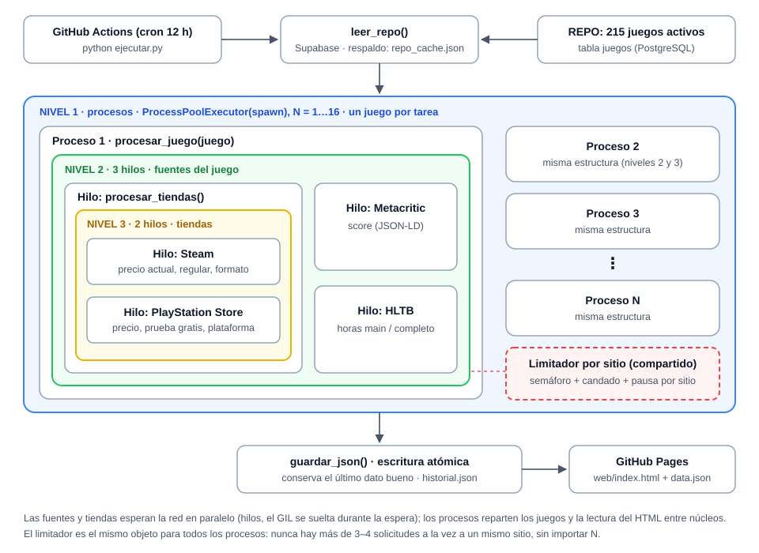

# 1. Arquitectura de la solución

El sistema lee la lista de juegos (REPO) de Supabase, consulta para cada juego dos tiendas, Metacritic y How Long To Beat usando tres niveles de paralelismo, guarda el resultado en `web/data.json` y lo publica en una página estática de GitHub Pages. GitHub Actions repite todo cada 12 horas.



## 1.1 Componentes

| Componente | Archivo | Qué hace |
|---|---|---|
| Programa principal | `ejecutar.py` | Lee el REPO, llama al motor, guarda el JSON y escribe las métricas de la corrida en `logs/metricas.jsonl` |
| Lectura del REPO | `scraper/repo.py` | Descarga los juegos activos de Supabase; si falla usa la copia local `datos/repo_cache.json` |
| Nivel 1 | `scraper/nivel1.py` | Reparte los juegos entre procesos |
| Nivel 2 | `scraper/nivel2.py` | Consulta las fuentes de un juego en hilos y arma su registro |
| Nivel 3 | `scraper/tiendas.py` | Consulta las tiendas de un juego en hilos |
| Scrapers | `scraper/tiendas.py`, `metacritic.py`, `hltb.py` | Extraen los datos de cada sitio |
| Red | `scraper/red.py` | Descarga con timeout, reintentos y el límite del sitio |
| Limitador | `scraper/limitador.py` | Controla cuántas solicitudes van a cada sitio a la vez, compartido por todos los procesos |
| Guardado | `scraper/guardar.py` | Combina con el JSON anterior, escribe de forma atómica y actualiza el historial de precios |
| Gestor | `gestor.py` | Ventana para agregar, editar y desactivar juegos del REPO |
| Página | `web/index.html` | Tarjetas, filtros, ordenamiento, detalle, comparador y rendimiento |
| Actualización | `.github/workflows/actualizar.yml` | Cron de 12 h y publicación en GitHub Pages |

## 1.2 Los tres niveles de paralelismo

| Nivel | Qué se reparte | Herramienta | Cuántos | Por qué |
|---|---|---|---|---|
| 1 | Juegos | `ProcessPoolExecutor` con contexto `spawn` | `WORKERS_JUEGOS`, por defecto los núcleos de la máquina | Cada proceso tiene su propio intérprete y su propio GIL, así que es el único nivel que usa varios núcleos de verdad (por ejemplo para leer el HTML con BeautifulSoup) |
| 2 | Fuentes de un juego: tiendas, Metacritic y HLTB | `ThreadPoolExecutor` | 3 hilos | Las tres fuentes pasan casi todo el tiempo esperando la red; mientras esperan sueltan el GIL, así que los hilos alcanzan y son más baratos que procesos |
| 3 | Tiendas de un juego: Steam y PlayStation Store | `ThreadPoolExecutor` | 2 hilos | Mismo motivo: un juego tarda lo que su tienda más lenta y no la suma de las dos |

Un juego viaja así: el nivel 1 le da el juego a un proceso libre; dentro de ese proceso `procesar_juego` abre 3 hilos (nivel 2); el hilo de tiendas abre otros 2 hilos (nivel 3). Cuando las fuentes terminan, el registro vuelve al proceso principal, que ordena todos por `id` y llama a `guardar_json`.

Se eligió `spawn` en vez de `fork` porque es el único que existe en Windows y se comporta igual en Windows, macOS y Linux, así el benchmark y GitHub Actions corren el mismo código.

## 1.3 Sincronización

- **Limitador por sitio compartido entre procesos.** El proceso principal crea, por cada sitio, un `BoundedSemaphore` (cuántas solicitudes a la vez), un `Lock` y un `Value` compartido con la hora del próximo turno libre. Se pasan a cada proceso hijo en el `initializer` del pool. Antes de cada descarga, `with turno(sitio)` toma un cupo del semáforo y reserva su turno dentro del candado; la espera se hace fuera del candado para no bloquear a los demás. Así, aunque haya 16 procesos, a Steam nunca le llegan más de 4 solicitudes a la vez ni a los demás sitios más de 3.
- **Log de varios procesos.** Cada hijo manda sus mensajes a una `multiprocessing.Queue`; un solo `QueueListener` en el proceso principal los escribe al archivo, así las líneas no se mezclan.
- **Resultados.** Los registros vuelven por los `Future` del pool (`as_completed`), sin memoria compartida ni candados extra. Solo el proceso principal escribe el `data.json`.
- **Tiempo máximo por juego.** El nivel 2 espera a cada fuente con un tope común (`TIMEOUT_FUENTE_S`, 180 s); una fuente colgada queda con error y no detiene al juego. Al terminar se usa `shutdown(wait=False, cancel_futures=True)` para no esperar hilos colgados.
- **Proceso que muere.** Si un proceso hijo se cae (`BrokenProcessPool`), sus juegos se repiten una vez en un pool nuevo; si vuelve a fallar quedan marcados con error y los demás juegos se guardan igual.

## 1.4 Formato del `data.json`

Un registro por juego:

```json
{
  "id": 12, "nombre": "Hades", "imagen": "https://…", "plataformas": ["PC", "PS5"],
  "fecha_lanzamiento": "2020-09-17", "precio_sugerido": 24.99,
  "tiendas": [
    {"tienda": "Steam", "ok": true, "precio_actual": 6.24, "precio_regular": 24.99, "descuento_pct": 75,
     "en_oferta": true, "formato": "Digital", "plataforma": "PC", "url": "https://store.steampowered.com/app/1145360/"}
  ],
  "metacritic": {"ok": true, "score": 93},
  "hltb": {"ok": true, "horas_main": 23.6, "horas_completo": 95.3},
  "ultima_actualizacion": "2026-11-15T18:00:00+00:00"
}
```

Si una fuente falla, su entrada queda con `"ok": false` y el texto del error; si había un dato anterior bueno, se conserva con `"desactualizado": true` (sección 3.10).
