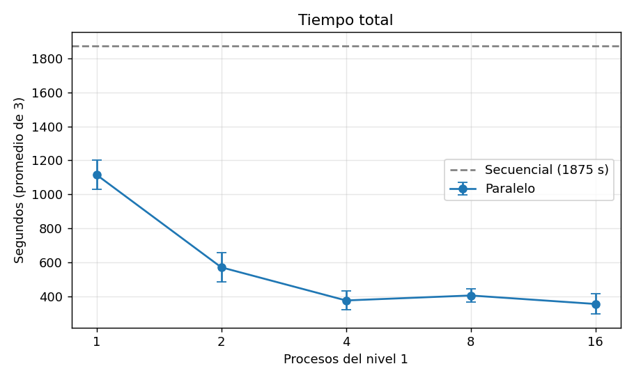
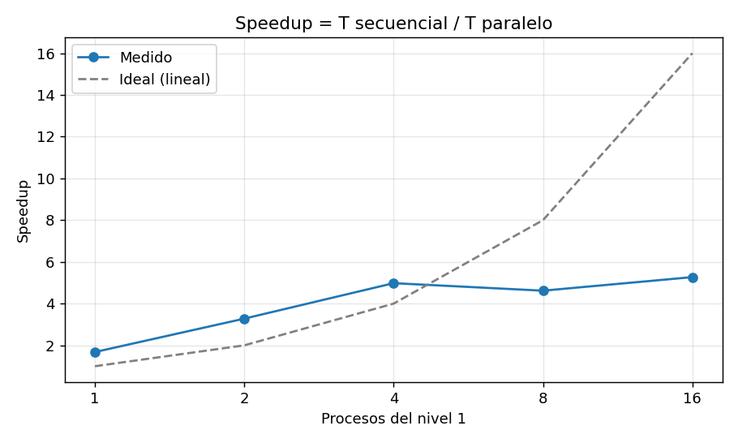
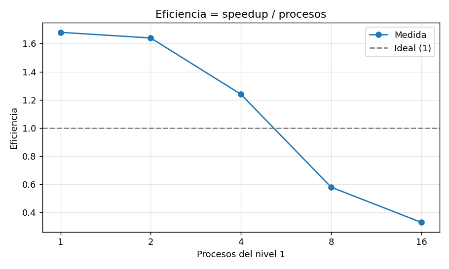

# 5. Análisis de rendimiento

> **Pendiente de medir.** Los espacios marcados con **[completar]** se llenan con los resultados de `python herramientas/benchmark.py`, que deja los números en `docs/benchmark/resumen.csv` y los gráficos en `docs/benchmark/*.png`. El razonamiento de esta sección no depende de los números exactos; hay que revisar que las conclusiones coincidan con lo medido.

## 5.1 Cómo se midió

- **Computadora:** siempre la misma, **[completar: procesador]**, con **[completar]** núcleos físicos y **[completar]** lógicos (Administrador de tareas → Rendimiento → CPU, o `Get-CimInstance Win32_Processor`). Los datos de la corrida quedan en `docs/benchmark/maquina.json`.
- **Carga:** los **[completar]** juegos activos del REPO, cada uno con Steam, PlayStation Store, Metacritic y HLTB, o sea 4 solicitudes por juego.
- **Configuraciones:** versión secuencial y 1, 2, 4, 8 y 16 procesos en el nivel 1. Los niveles 2 y 3 usan siempre 3 y 2 hilos.
- **Versión secuencial:** el mismo código con los tres niveles en 1 worker (`python ejecutar.py --secuencial`): un proceso, y las fuentes y tiendas de cada juego una después de otra.
- **Repeticiones:** 3 por configuración, intercaladas (secuencial, 1, 2, …, 16, y otra vez) para repartir el ruido de la red entre todas. Se reporta el promedio y la desviación estándar.
- **Medida:** `duracion_s` es el tiempo de procesar todos los juegos (sin contar leer Supabase ni escribir el JSON), medido con `time.perf_counter`.
- **Fórmulas:** speedup = T secuencial / T paralelo; eficiencia = speedup / procesos.

## 5.2 Resultados

| Configuración | Tiempo promedio (s) | Desv. (s) | Speedup | Eficiencia |
|---|---|---|---|---|
| Secuencial | [completar] | | 1.00 | 1.00 |
| 1 proceso | [completar] | | | |
| 2 procesos | [completar] | | | |
| 4 procesos | [completar] | | | |
| 8 procesos | [completar] | | | |
| 16 procesos | [completar] | | | |

Los mismos resultados se ven en la pestaña **Rendimiento** de la página publicada: el benchmark escribe `web/rendimiento.json` y la web dibuja los gráficos.

## 5.3 Por qué la eficiencia puede salir mayor que 1

Con **1 proceso** el programa ya es más rápido que la versión secuencial, aunque usa un solo núcleo. La razón es que los niveles 2 y 3 siguen activos: dentro de ese proceso las 4 solicitudes de cada juego salen al mismo tiempo en hilos. Mientras un hilo espera la respuesta de la red suelta el GIL y otro puede trabajar, así que la espera de la red se solapa. En una prueba con scrapers falsos (0.2 s por página, 24 juegos, sin límite por sitio) la versión secuencial tardó 19.3 s y la de 1 proceso 5.5 s: speedup de 3.5 con un solo proceso.

Por eso la eficiencia medida contra la versión secuencial puede ser mayor que 1. No es un error: el speedup no viene solo de usar más núcleos sino de esperar la red en paralelo. **[completar: valor medido con 1 proceso]**

## 5.4 Cuellos de botella

1. **La red (domina).** Procesar un juego casi no usa CPU: es descargar 4 páginas y leer unos pocos elementos del HTML. Casi todo el tiempo el programa está esperando respuestas. Por eso los hilos (niveles 2 y 3) aportan tanto como los procesos.
2. **El límite por sitio (el techo).** Para no saturar a ningún sitio, `limitador.py` deja pasar pocas solicitudes a la vez por sitio y obliga a una pausa entre solicitudes. Eso pone un tiempo mínimo que ningún número de procesos puede bajar:

   | Sitio | A la vez | Pausa | Máximo de solicitudes por segundo |
   |---|---|---|---|
   | Steam | 4 | 0.3 s | ≈ 3.3 |
   | PS Store | 3 | 0.5 s | 2 |
   | Metacritic | 3 | 0.5 s | 2 |
   | HLTB | 3 | 0.5 s | 2 |

   Con N juegos, los sitios con pausa de 0.5 s necesitan por lo menos N × 0.5 s. Con **[completar: N]** juegos son **[completar]** s. Cuando el tiempo medido se acerca a ese piso, agregar procesos ya no ayuda: los procesos de más solo hacen fila en el semáforo del sitio. **[completar: a partir de cuántos procesos se aplana la curva]**
3. **La CPU (poca).** Leer el HTML con BeautifulSoup sí usa CPU y ahí es donde varios procesos ayudan de verdad, porque cada proceso tiene su propio GIL. Pero es una parte pequeña del tiempo total.
4. **Arranque de procesos.** En Windows los procesos se crean con `spawn`: cada uno arranca un Python nuevo e importa los módulos (≈ 0.3–1 s cada uno). Con 16 procesos y pocos juegos por proceso ese costo se nota.
5. **Núcleos lógicos.** Si la computadora tiene 8 núcleos físicos con 2 hilos de hardware cada uno (16 lógicos), de 8 a 16 procesos se comparten núcleos físicos. Para un programa que casi no usa CPU eso importa poco, pero conviene decirlo al interpretar el punto de 16.

## 5.5 Efecto de cada nivel

| Nivel | Qué paraleliza | Con qué | Qué aporta |
|---|---|---|---|
| 1 | Juegos | Procesos | Usa varios núcleos (un GIL por proceso). Ayuda en la parte de CPU y multiplica las esperas de red que se solapan |
| 2 | Fuentes de un juego (tiendas, Metacritic, HLTB) | 3 hilos | Un juego tarda lo que su fuente más lenta, no la suma de las tres |
| 3 | Tiendas de un juego | 2 hilos | Steam y PS Store se consultan a la vez |

La diferencia entre "secuencial" y "1 proceso" mide el aporte de los niveles 2 y 3 juntos; la curva de 1 a 16 procesos mide el aporte del nivel 1. **[completar con los números]**

## 5.6 Ley de Amdahl

Si una fracción *p* del trabajo se puede paralelizar y el resto (1 − *p*) no, el speedup máximo con *n* procesos es

S(n) = 1 / ((1 − p) + p / n)

y nunca pasa de 1 / (1 − p) aunque *n* crezca sin límite. En este programa la parte "no paralelizable" no es solo código secuencial (leer el REPO, arrancar procesos, escribir el JSON) sino sobre todo el **límite por sitio**: es un recurso compartido por todos los procesos, así que se comporta como una parte serial.

Despejando *p* del speedup medido con 16 procesos (tomando 1 proceso como base, para aislar el nivel 1):

p = (1 − 1/S) / (1 − 1/n) = **[completar]**

Con ese *p*, el speedup máximo teórico es 1 / (1 − p) = **[completar]**. Esto coincide con el piso que pone el límite por sitio (5.4): por más procesos que se agreguen, el tiempo no baja de ahí. Para bajarlo habría que subir los límites por sitio, que es justo lo que no se quiere hacer para no saturar a las tiendas.

## 5.7 Conclusiones

- **[completar]** El mayor salto viene de los hilos (niveles 2 y 3), porque el programa pasa la mayor parte del tiempo esperando la red.
- **[completar]** Los procesos (nivel 1) siguen mejorando hasta **[completar]** procesos; después la curva se aplana por el límite por sitio.
- La configuración recomendada para la corrida diaria es **[completar]** procesos: más allá de eso no se gana tiempo y se crean procesos que solo esperan.
